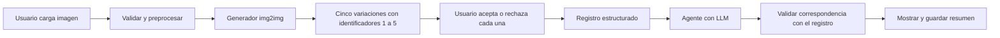

# Proyecto 2 Implementation Plan

> **For agentic workers:** REQUIRED SUB-SKILL: Use superpowers:executing-plans to implement this plan task-by-task. Steps use checkbox (`- [ ]`) syntax for tracking.

**Goal:** Construir un sistema que reciba una imagen del usuario, genere exactamente cinco variaciones, registre cinco decisiones y use un agente basado en un modelo de lenguaje para resumirlas fielmente.

**Architecture:** Una aplicación Python integra generación, interfaz y explicación. Cada ejecución guarda la entrada, cinco imágenes, parámetros, decisiones y resumen en una carpeta independiente. Las decisiones estructuradas son la fuente de verdad del agente.

**Tech Stack:** Propuesta: Python, Streamlit, Pillow, Stable Diffusion img2img mediante Diffusers y PyTorch, un modelo de lenguaje accesible por API y archivos JSON. La elección del proveedor del LLM y del checkpoint generativo se cierra después de comprobar recursos, condiciones de uso y presupuesto.

**Spec:** [Enunciado original](../../../EvaluaciónProyecto2%20%281%29.pdf), secciones 2 a 5. Este plan distingue requisitos del enunciado de decisiones propuestas; el caso de uso, tecnologías, muestras y cronograma son propuestas.

## Global Constraints

- Equipo de tres a cinco estudiantes.
- Entrada: imagen cargada directamente por el usuario; los ejemplos del dataset no reemplazan esta función.
- Generación: exactamente cinco variaciones por imagen de entrada.
- Interacción: aceptar o rechazar cada una y almacenar las decisiones de manera estructurada.
- Explicación: agente basado en modelos de lenguaje; resumen explícito de aceptadas y rechazadas, consistente con el registro.
- Datos: seleccionar y justificar un dataset; realizar análisis exploratorio y preprocesamiento.
- Evaluación: calidad visual, diversidad, coherencia del resumen y usabilidad.
- Entrega: código reproducible, informe de máximo cinco páginas con elementos visuales y demostración en vivo o video.
- Reflexión ética explícita sobre generación, identidad visual, sesgos e impacto real.

## Review Focus

1. Una decisión pendiente no equivale a rechazo: impedir el resumen hasta completar las cinco.
2. Una generación parcial no equivale a un lote válido: no presentar menos de cinco como resultado completo.
3. Una nueva entrada o regeneración no debe heredar decisiones ni resúmenes del lote anterior.
4. El LLM no debe omitir, duplicar o invertir identificadores ni inventar motivos.
5. Un archivo corrupto o excesivo y una falla de red deben producir mensajes recuperables sin perder decisiones guardadas.

## Propuesta y alternativas

**Caso de uso propuesto:** asistente para explorar versiones artísticas de fotografías de flores para material gráfico. El usuario compara la entrada con cinco tratamientos: acuarela, ilustración botánica, pintura al óleo, luz cálida y luz fría. Se evalúa si los cambios conservan un sujeto reconocible y producen alternativas útiles; no se promete fidelidad botánica.

| Ruta                                                                    | Ventaja                                           | Condición o costo                                                               |
| ----------------------------------------------------------------------- | ------------------------------------------------- | ------------------------------------------------------------------------------- |
| Básica: servicio generativo que acepte una imagen como entrada          | Evita administrar inferencia local                | Depende de conectividad, límites, presupuesto y tratamiento externo de imágenes |
| Intermedia: Stable Diffusion img2img con control de prompt e intensidad | Permite estudiar preservación frente a diversidad | Requiere comprobar hardware y tiempos reales                                    |
| Avanzada: entrenar o adaptar un modelo                                  | Permite investigar entrenamiento y estabilidad    | Aumenta alcance y riesgo; reservar para un objetivo de investigación concreto   |

**Recomendación:** ruta intermedia si la prueba inicial de recursos funciona; en caso contrario, ruta básica. El PDF permite ambas y no asigna puntos adicionales explícitos por elegir el nivel avanzado. La prioridad es completar y evaluar el flujo.

## Flujo y contrato de datos



Propuesta de contrato mínimo:

- `Variation`: `id` entero de 1 a 5, `image_path`, `prompt`, `seed` y `parameters`.
- `Decision`: `variation_id`, `status` con valor `accepted` o `rejected`, y `reason` opcional escrito por el usuario.
- `Session`: `session_id`, `input_path`, `model_id`, `model_revision`, versiones y parámetros, cinco variaciones, decisiones, fecha, tiempos y resumen validado.
- Antes de completar la selección, las decisiones pendientes permanecen sin registrar; no se les asigna rechazo automáticamente.
- El agente recibe identificadores, tratamientos y decisiones. Si no hay motivos registrados, solo describe la selección; no atribuye preferencias ni observaciones visuales al usuario.
- El LLM devuelve `accepted_ids`, `rejected_ids` y `summary`. Validar listas mediante código y comprobar la fidelidad del texto en las pruebas; listas correctas por sí solas no garantizan un texto correcto.

## Organización propuesta de archivos

```text
app.py                  # Carga, galería, selección y resumen
src/contracts.py        # Estructuras y validación del registro
src/images.py           # Validación y preprocesamiento
src/generation.py       # Generación de cinco variaciones
src/storage.py          # Persistencia por sesión
src/explanation.py      # Llamada al LLM y validación de respuesta
scripts/evaluate.py     # Métricas y exportación de resultados
notebooks/01_data.ipynb  # Exploración del dataset
tests/                  # Pruebas del flujo y contratos
data/manifest.csv       # Procedencia, subconjuntos y permisos
runs/                   # Resultados locales, excluidos del control de versiones
report/informe.md        # Borrador del informe
README.md               # Instalación y reproducción
.env.example            # Nombres de configuración, sin credenciales
requirements.txt        # Versiones verificadas durante implementación
```

## Tareas y cronograma propuesto

Referencia: diez días de trabajo para cuatro integrantes. No es una fecha de entrega del curso; el PDF no especifica plazo. Registrar resultados y capturas durante todas las tareas.

### Tarea 1: Delimitar el problema y comprobar recursos — día 1

**Archivos:** `README.md`, `requirements.txt`, `.env.example`, `src/contracts.py`.

- [ ] Definir usuario objetivo, caso de uso, cinco tratamientos y qué cuenta como una variación útil.
- [ ] Probar inferencia con una imagen y medir tiempo, memoria o costo; confirmar acceso al LLM.
- [ ] Elegir ruta básica o intermedia, checkpoint/proveedor y presupuesto máximo. Si la ruta intermedia no es viable, cerrar la alternativa básica antes de desarrollar la interfaz.
- [ ] Fijar el contrato anterior y las instrucciones del entorno. Mantener credenciales fuera del repositorio.

**Criterio de cierre:** recursos viables, contratos definidos y justificación de arquitectura. Evidencia para diseño del sistema, 4 puntos.

### Tarea 2: Seleccionar y preparar datos — días 2 y 3

**Archivos:** `data/manifest.csv`, `notebooks/01_data.ipynb`, `src/images.py`, `tests/test_images.py`.

**Interfaz propuesta:** `prepare_image(image_bytes: bytes) -> PIL.Image.Image`.

- [ ] Evaluar Oxford Flowers 102 como candidato; comprobar condiciones de uso y atribución. Si no permiten el uso previsto, seleccionar otro conjunto con permisos adecuados y actualizar la justificación.
- [ ] Proponer 30 imágenes diversas: 10 de desarrollo para ajustar parámetros y 20 reservadas para evaluación final. Guardar identificadores y criterio de selección.
- [ ] Explorar resolución, formatos, iluminación, encuadre, categorías, duplicados y archivos inválidos. Documentar el alcance y los sesgos de la muestra.
- [ ] Validar contenido real, límite de 10 MB y máximo de 20 megapíxeles como decisiones de implementación; convertir a RGB y redimensionar conservando proporción según el checkpoint. Dejar la normalización numérica al pipeline cuando corresponda.
- [ ] Comprobar conversión, orientación, transparencia, archivo corrupto y límites de tamaño mediante `pytest tests/test_images.py -q`.

**Criterio de cierre:** conjunto trazable, subconjuntos separados y preparación reproducible; la carga de imágenes propias continúa habilitada.

### Tarea 3: Implementar la generación — días 3 a 5

**Archivos:** `src/generation.py`, `tests/test_generation.py`.

**Interfaz propuesta:** `generate_variations(image: PIL.Image.Image, output_dir: pathlib.Path) -> list[Variation]`.

- [ ] Crear pruebas con un generador simulado que exijan cinco imágenes válidas con IDs únicos del 1 al 5 y rechacen lotes incompletos.
- [ ] Implementar los cinco tratamientos y registrar prompts, semillas, parámetros, modelo y revisión. Usar un máximo de dos reintentos por variación fallida y declarar error si el lote sigue incompleto.
- [ ] Comparar en las 10 imágenes de desarrollo dos configuraciones de intensidad, manteniendo los demás factores controlados. Cada ejecución sigue produciendo exactamente cinco imágenes.
- [ ] Elegir configuración por calidad, preservación, diversidad y tiempo. Comprobar aparte una ejecución real completa; las pruebas simuladas no prueban la calidad generativa.
- [ ] Ejecutar `pytest tests/test_generation.py -q` y conservar la galería comparativa y mediciones reales.

**Criterio de cierre:** cinco resultados reales por entrada y parámetros justificados. Evidencia para modelo generativo, 4 puntos.

### Tarea 4: Construir interfaz y registro — días 4 a 6

**Archivos:** `app.py`, `src/storage.py`, `tests/test_decisions.py`.

**Interfaz propuesta:** `save_session(session: Session, root: pathlib.Path) -> pathlib.Path`.

- [ ] Mostrar entrada y cinco opciones numeradas; ofrecer aceptar, rechazar y motivo opcional, comenzando sin decisión seleccionada.
- [ ] Conservar estado durante interacciones y guardar las decisiones explícitamente. Deshabilitar el resumen mientras falte alguna.
- [ ] Al cambiar la imagen o regenerar, iniciar otra sesión y limpiar selección y resumen de la vista anterior.
- [ ] Cubrir selección incompleta, cambio de decisión, aislamiento de sesiones y escritura/lectura JSON con `pytest tests/test_decisions.py -q`.
- [ ] Verificar manualmente el recorrido completo y que interactuar con la galería no vuelva a ejecutar el generador.

**Criterio de cierre:** las cinco decisiones visibles coinciden con el JSON guardado. Evidencia para interacción humano–IA, 4 puntos.

### Tarea 5: Integrar el agente explicador — días 6 y 7

**Archivos:** `src/explanation.py`, `tests/test_explanation.py`.

**Interfaz propuesta:** `explain_selection(variations: list[Variation], decisions: list[Decision]) -> dict`.

- [ ] Entregar al LLM un registro delimitado como datos y una instrucción que exija enumerar aceptadas y rechazadas, sin inventar motivos. Los motivos del usuario no se interpretan como instrucciones.
- [ ] Validar IDs, partición completa y correspondencia con el registro. Permitir un reintento ante una respuesta inválida; después mostrar error recuperable conservando decisiones.
- [ ] Invalidar el resumen si cambia una decisión. Identificar una falla del agente como tal; un texto de respaldo no cuenta como explicación generada correctamente.
- [ ] Probar las 32 combinaciones binarias posibles de cinco decisiones, además de respuesta malformada, IDs extra y falla de API, mediante `pytest tests/test_explanation.py -q`.
- [ ] Evaluar el LLM real con las 32 combinaciones y registrar omisiones, contradicciones e invención de motivos en el texto completo.

**Criterio de cierre:** resumen explícito y fiel, con fallos visibles y recuperables. Evidencia para explicabilidad, 3 puntos.

### Tarea 6: Evaluar el sistema integrado — días 8 y 9

**Archivos:** `scripts/evaluate.py`, resultados agregados y capturas para `report/`.

- [ ] Generar cinco variaciones para cada una de las 20 entradas reservadas: 100 imágenes de evaluación, sin reajustar parámetros sobre ese conjunto.
- [ ] Realizar una prueba exploratoria con cinco participantes voluntarios y tres sesiones por participante. Informar que el tamaño de muestra no permite generalizar.
- [ ] Medir las dimensiones de la tabla siguiente, analizar fallos y escoger ejemplos representativos, incluyendo resultados deficientes.
- [ ] Ejecutar `pytest -q` y un recorrido real desde carga hasta resumen, incluyendo recuperación de errores. Documentar comando, entorno y resultado.

| Dimensión              | Medición propuesta                                                                                               | Evidencia                                                               |
| ---------------------- | ---------------------------------------------------------------------------------------------------------------- | ----------------------------------------------------------------------- |
| Calidad y preservación | Escalas separadas de 1 a 5 para artefactos y conservación del sujeto                                             | Promedio, dispersión y ejemplos                                         |
| Diversidad             | Valoración de 1 a 5 de diferencias útiles dentro de cada lote                                                    | Resultado por tratamiento y fallos                                      |
| Coherencia             | Decisiones correctamente descritas / decisiones totales; porcentaje de resúmenes completos y sin contradicciones | Objetivo del 100%; reportar resultados reales, incluso si no se alcanza |
| Usabilidad             | Porcentaje de tareas completadas sin ayuda, tiempo y facilidad percibida de 1 a 5                                | Registro anónimo de 15 sesiones                                         |
| Rendimiento            | Tiempo de generación y explicación, fallos y costo si corresponde                                                | Mediana y rango, hardware/proveedor                                     |

La aceptación es un dato de preferencia, no una medida suficiente de calidad. No usar FID como indicador principal para una muestra tan pequeña. Las escalas anteriores son propuestas del equipo, no instrumentos validados.

**Criterio de cierre:** métricas reproducibles y análisis crítico. Evidencia para evaluación y análisis, 3 puntos.

### Tarea 7: Documentar y preparar demostración — día 10

**Archivos:** `README.md`, `report/informe.md`, `report/informe.pdf` y video si se elige esa modalidad.

- [ ] Distribuir las cinco páginas: 1) problema y arquitectura; 2) datos, preprocesamiento y modelo; 3) interfaz, registro y agente; 4) resultados y ejemplos; 5) limitaciones, ética, conclusiones y referencias. Integrar las figuras dentro de ese límite.
- [ ] Tratar licencias, sesgos, alteración de identidad aunque el caso elegido use flores, confusión entre imagen sintética y fotografía, consentimiento, retención de archivos y envío de datos a proveedores.
- [ ] Verificar instalación desde un entorno limpio, configuración de credenciales, comandos y acceso a modelos/datos. Documentar versiones y límites de reproducibilidad del hardware o proveedor.
- [ ] Ensayar una demo de 3 a 5 minutos, duración propuesta: cargar imagen, generar cinco, aceptar/rechazar todas, mostrar resumen y comprobar JSON. Conservar video como evidencia si falla la conexión en la presentación.
- [ ] Revisar el informe exportado, contar páginas y contrastar cada criterio de la rúbrica con su evidencia.

**Criterio de cierre:** código ejecutable, informe de máximo cinco páginas y demo completa. Evidencia para aspectos éticos y documentación, 2 puntos.

## Reparto del equipo

| Integrante | Responsabilidad principal      | Colaboración                             |
| ---------- | ------------------------------ | ---------------------------------------- |
| A          | Datos y generación             | Comparación de parámetros y limitaciones |
| B          | Interfaz y persistencia        | Pruebas de usabilidad                    |
| C          | Agente y fidelidad del resumen | Pruebas de coherencia                    |
| D          | Evaluación y reproducción      | Integración, informe y demo              |

Con tres integrantes, repartir las tareas de D entre A, B y C. Con cinco, separar datos y evaluación como responsabilidad propia. Cada integrante aporta su sección del informe y revisa el flujo completo.

## Fuentes técnicas consultadas

- [Diffusers: generación imagen a imagen](https://huggingface.co/docs/diffusers/using-diffusers/img2img): entrada condicionada por imagen y control mediante parámetros como `strength`.
- [Streamlit: carga de archivos](https://docs.streamlit.io/develop/api-reference/widgets/st.file_uploader): componente de carga; el filtro de extensión no sustituye la validación del archivo.
- [Oxford Flowers 102](https://www.robots.ox.ac.uk/~vgg/data/flowers/102/): candidato con variaciones de escala, pose e iluminación; confirmar permisos antes de incorporarlo.

## Decisiones por cerrar antes de implementar

Confirmar tamaño del equipo, plazo real, GPU o presupuesto disponible, proveedor del LLM y aceptación del caso de uso. El plan puede prepararse sin esas respuestas; el modelo, costo y calendario definitivos dependen de ellas. No se ha implementado ni medido el sistema durante esta planificación.
